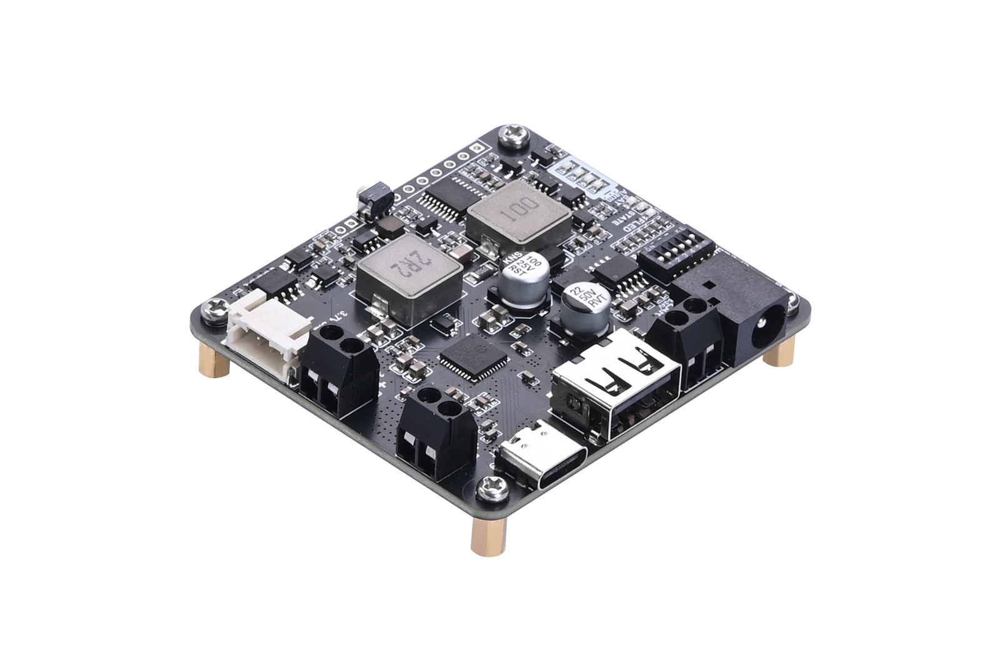
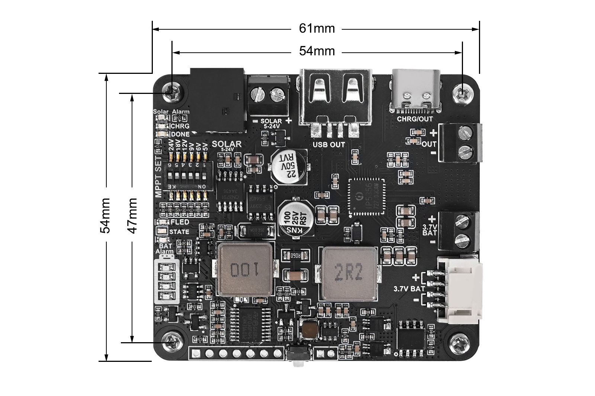

# SOLAR/BATTERY MANAGEMENT SYSTEM

The Solar Energy Manager A is a solar power management module supporting charging 3.7V 18650 lithium batteries via solar panels and USB interface. Features MPPT (Maximum Power Point Tracking) and charge-discharge protection with 5V/3.1A regulated output.

<model-viewer
    src="../../../static/models/bms.glb"
    alt="BMS 3D model"
    camera-controls
    auto-rotate
    auto-rotate-delay="3000"
    rotation-per-second="1deg"
    interaction-prompt="none"
    shadow-intensity="0.6"
    exposure="0.5"
    environment-image="legacy"
    orientation="0deg 0deg 30deg"
    ar
    ar-modes="webxr scene-viewer quick-look"
    style="display: block; width: 100%; height: 600px;">
</model-viewer>

*3D Model*

*Appearance*

*Dimensions*

## Key Specifications

| Parameter | Value |
|-----------|-------|
| Solar Input | 5-24V |
| USB Output | 5V/3.1A |
| Battery | 3.7V 18650 Lithium |
| Charge Protection | 4.2V ±1% |
| Discharge Protection | 3.0V ±1% |
| Dimensions | 61mm × 54mm |
| Weight | 28g |

## Resources

-   :material-file:{ .lg .middle } __Product Information__

    ---

    [:octicons-arrow-right-24: <a href="https://seengreat.com/wiki/161/" target="_blank"> View </a>](#)

## Mounting Design

- **PCB Holes** As shown in the image above, the PCB has mounting holes with a diameter of 3mm for M2.5 screw installation.

- **Screws** The screws used are M2.5x5, with an outer diameter of 2.5mm and a length of 5mm, designed to be used with heat-set inserts.

- **Heat-Set Inserts** The heat-set inserts are embedded in the 3D printed parts. During installation, the insert is heated and pressed into the pre-designed hole to ensure a secure fit. The specifications for the heat-set insert are M2.5x4x4, with an inner diameter of 2.5mm, a height of 4mm, and an outer diameter of 4mm.

## Measured board sleep current

A preliminary offline current check was performed on Flores deployment node 000 on 7 November 2026. LiftNode and NexNode documentation share this same test record; **this does not mean that two separate hardware platforms were measured**.

| MCU state | Coarse indicated current | Validation |
| --- | --- | --- |
| Awake idle | Approximately 42 mA | Stable reading confirmed after the LED was off in the first run |
| Light sleep | Approximately 3 mA | Read about 5 s after the two-flash marker in the corrected run; timer exit and sensor readback passed |
| Deep sleep | Approximately 1 mA | Read about 5 s after the three-flash marker in the corrected run; timer wake, sensor readback and SD report completion passed |

### Measurement boundary and fixed conditions

- Connection: power manager nominal 5 V output positive → current meter → main-board supply positive, with ground directly connected. The boundary includes the main board, sensing expansion board and SD card, and excludes power-manager losses.
- Instrument: Fluke 179, DC A range, red lead in the 10 A input and black lead in COM. The selected display increment was 0.001 A (1 mA), which is resolution, not a calibrated accuracy or uncertainty.
- All main-board USB cables and the power-manager charging cable were removed during measurement to prevent bypass supplies. Switch power off before changing wiring, sockets or ranges. Connect the current meter in series, never across supply positive and negative.
- ADXL367: ±2g, 100 Hz measurement. ADXL355: ±2g standby. SD: mounted and idle. Wi-Fi and ESP-NOW: never initialized. RGB LED: off during steady readings. Awake CPU: fixed 240 MHz.
- Each state lasted approximately 90 s. One, two and three blue flashes marked awake, light sleep and deep sleep; four flashes indicated successful timer wake and report completion. The approximately 42 mA reading after wake is not deep-sleep current.

### Interpretation

The approximately 1 mA deep-sleep indication is at one display increment of the selected range and is preliminary. These are whole-board indications, not bare-MCU current, and no repeatability statistics or calibrated uncertainty were obtained. Input voltage was not measured simultaneously; power, task energy and battery lifetime are not inferred.

The completed SD report records 89.992 s of light sleep, timer-caused deep-sleep wake, retained sensor configurations and DONE. An earlier run failed ADXL355 readback because the bench program reconfigured SPI chip select after light sleep; its red-blinking approximately 42 mA error state was excluded. The corrected run completed successfully. This is not evidence of failed sensor hardware and does not validate seismic-trigger wake from deep sleep in deployment. The original acquisition firmware was restored afterward and storage, both sensors, arming and connectivity were checked.

Evidence: [completed SD report](POWER-BENCH-20261107/completed-report.txt), [manual readings and session status](POWER-BENCH-20261107/measurement-session.json), [bench firmware source](POWER-BENCH-20261107/power-bench-source.txt), [firmware verification record](POWER-BENCH-20261107/firmware-manifest.json).
