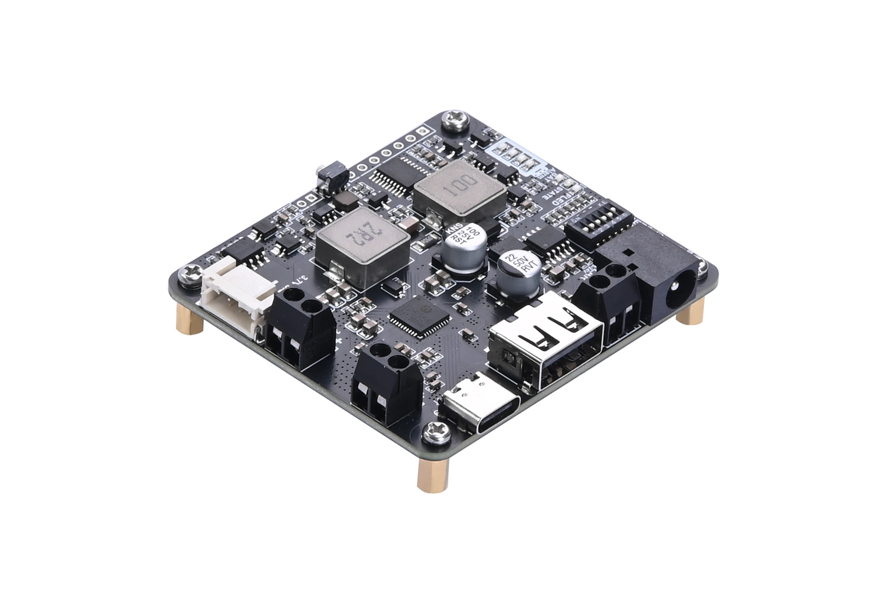
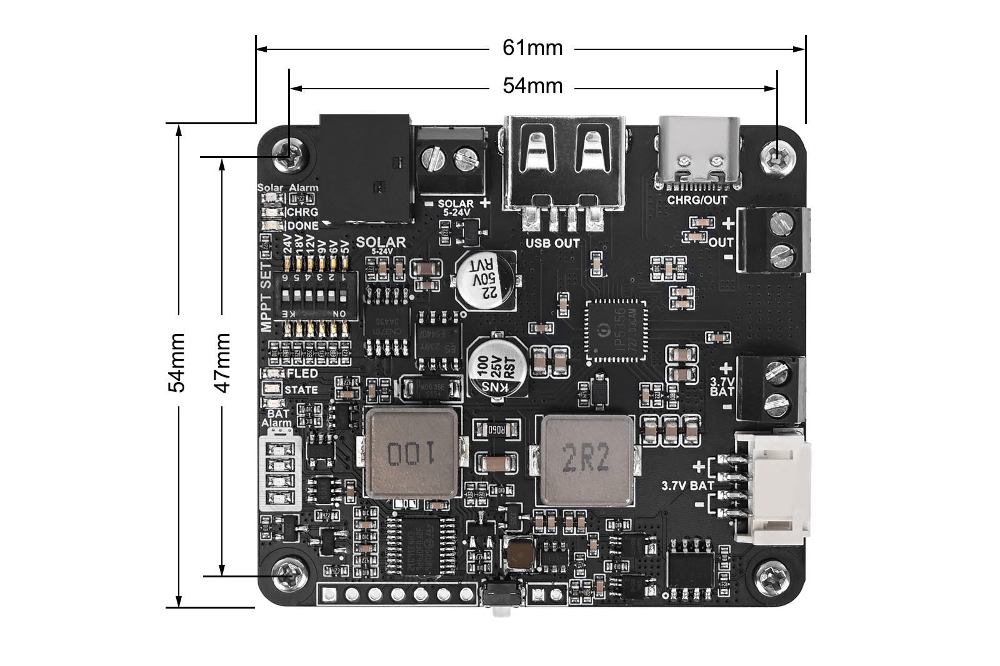

# 太阳能/电池管理模块

太阳能能源管理模块A支持通过太阳能电板和USB接口为3.7V 18650锂电池充电，配备5V/3.1A电压调节输出。集成MPPT（最大功率点跟踪）和电池充放电保护功能。

<model-viewer
    src="../../../../static/models/bms.glb"
    alt="BMS 3D model"
    camera-controls
    auto-rotate
    auto-rotate-delay="3000"
    rotation-per-second="1deg"
    interaction-prompt="none"
    shadow-intensity="0.6"
    exposure="0.5"
    environment-image="legacy"
    orientation="0deg 0deg 30deg"
    ar
    ar-modes="webxr scene-viewer quick-look"
    style="display: block; width: 100%; height: 600px;">
</model-viewer>

*3D模型*

*外观图*

*尺寸图*

## 关键规格

| 参数 | 规格 |
|------|------|
| 太阳能输入 | 5-24V |
| USB输出 | 5V/3.1A |
| 电池 | 3.7V 18650锂电池 |
| 充电保护 | 4.2V ±1% |
| 放电保护 | 3.0V ±1% |
| 尺寸 | 61mm × 54mm |
| 重量 | 28g |

## 资源下载

-   :material-file:{ .lg .middle } __产品详情页__

    ---

    [:octicons-arrow-right-24: <a href="https://seengreat.com/wiki/161/" target="_blank"> 查看 </a>](#)

## 挂载设计

- **PCB开孔** 如上图所示，PCB开孔直径为3mm，使用于M2.5螺丝安装。

- **螺丝** 螺丝规格为M2.5x5，螺丝外径2.5mm，长度5mm，配合热熔螺母使用。

- **热熔螺母** 螺母选用热熔螺母，内嵌于3D打印件中，安装时将螺母加热后压入预留孔位，确保牢固固定。其规格为M2.5x4x4，即内径2.5mm，高度4mm，外径4mm。

## 主板睡眠电流实测

2026年11月7日，使用Flores部署项目的000节点进行了一次离线整板电流初测。本节在LiftNode与NexNode文档中共享同一份测试记录，**不代表两种硬件分别完成了测量**。

| 主控状态 | 电流粗测 | 验证情况 |
| --- | --- | --- |
| 常醒空闲 | 约42 mA | 首轮蓝灯熄灭后稳定读数已确认 |
| 浅睡眠 | 约3 mA | 修复版两次蓝闪结束约5秒后读数；定时唤醒与传感器回读通过 |
| 深睡眠 | 约1 mA | 修复版三次蓝闪结束约5秒后读数；定时唤醒、传感器回读和SD结果写入通过 |

### 接线和固定条件

- 测量位置：电源管理板标称5V输出正极 → 万用表 → 主板供电正极；负极直接连接。包含主板、传感器扩展板和SD，不包含电源管理板自身损耗。
- 仪表：Fluke 179，直流A档，红表笔10A孔、黑表笔COM孔；本次显示步进0.001 A，即1 mA。这是分辨率，不能当作测量准确度或误差范围。
- 主板所有USB线及电源板充电线在测量时拔除，避免旁路供电。接线、换孔或换档前先断电；电流表串联，禁止跨接电源正负极。
- ADXL367保持±2g、100 Hz测量；ADXL355保持±2g待机；SD挂载空闲；Wi-Fi和ESP-NOW不初始化；稳定读数阶段RGB熄灭。常醒CPU固定240 MHz。
- 三个工况各约90秒；蓝闪1、2、3次分别标记常醒、浅睡和深睡，蓝闪4次表示深睡定时唤醒和结果检查完成。醒后约42 mA不属于深睡电流。

### 结果范围

深睡约1 mA处于本次档位的一个显示步进，只能作为初步指示值；这不是裸ESP32芯片电流，也没有重复性统计或校准后的不确定度。未同时测量输入电压，因此不据此计算功率、任务能量或电池续航。

完成轮SD日志记录浅睡89.992秒、深睡定时唤醒、两颗传感器配置保留和DONE。此前一次测试因浅睡后测试程序重新配置SPI片选导致ADXL355回读失败，红闪约42 mA为被排除的报错状态；修复后完整通过。这不证明传感器硬件故障，也不等于已验证部署中的深睡地震触发唤醒。测后已恢复原正式采集固件并确认SD、双传感器、布防和联网正常。

原始记录：[完成轮SD日志](POWER-BENCH-20261107/completed-report.txt)、[读数与测量状态](POWER-BENCH-20261107/measurement-session.json)、[测试固件源码](POWER-BENCH-20261107/power-bench-source.txt)、[固件校验记录](POWER-BENCH-20261107/firmware-manifest.json)。
