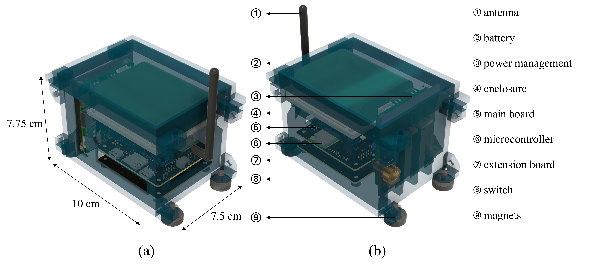
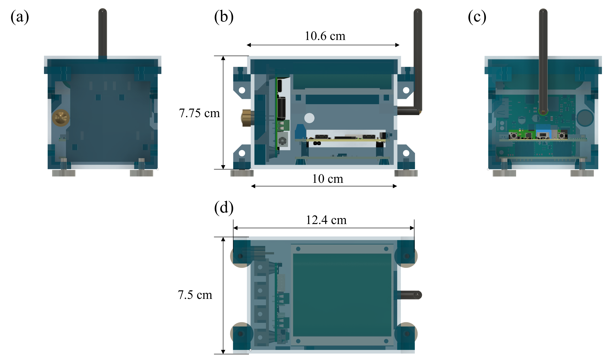
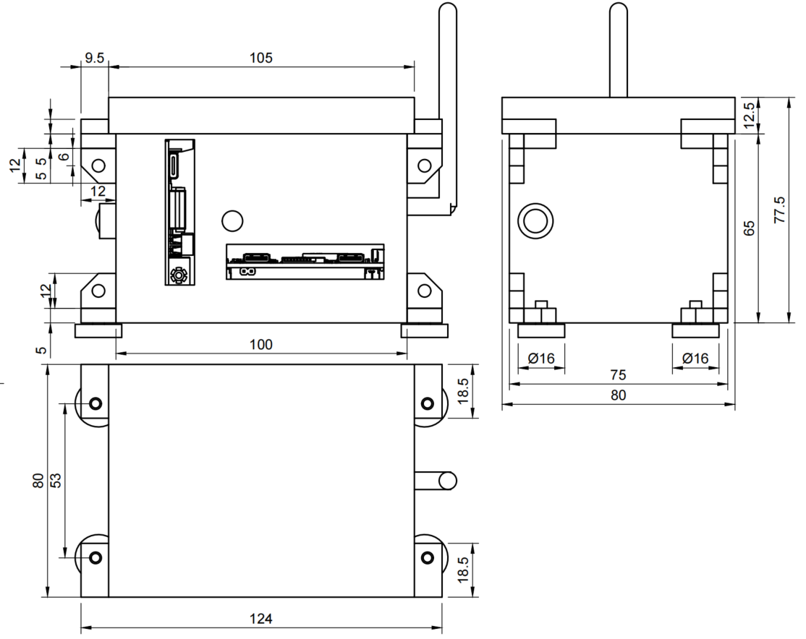
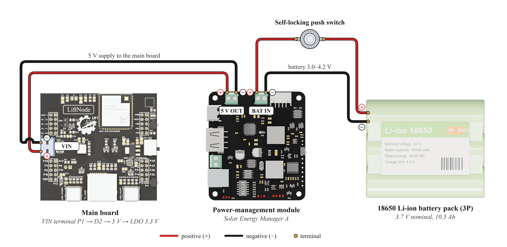

# MECHANICAL DESIGN

Mechanical design largely determines the flexibility and suitability of the node during deployment and installation. In this project, the node's mechanical design balances functionality and aesthetics, aiming to remain as compact as possible while still supporting long-term deployment.

<liftnode-viewer lang="en" brand="NEXNODE"></liftnode-viewer>

*Interactive exploded view: drag to orbit, scroll to zoom, use the toolbar to explode the assembly or switch between studio / X-ray / blueprint rendering. The enclosure, lid, battery plate and BMS frame are the Fusion 360 exports (the one-piece enclosure is split into base + four walls only so it can unfold); PCBs, battery, antenna and magnets are simplified stand-ins.*

{width=100%}

*Mechanical design overview: (a) overall dimension diagram; (b) key component annotation diagram*

The figure above shows the overall mechanical design of the node. We use a robust and durable enclosure to protect internal components, while reserving sufficient space for various interfaces and functional modules. The enclosure adopts a modular design to make maintenance and upgrades easier. The figure also shows node dimensions and the positions of key components. During design, we carefully considered space utilization to ensure enough room between components for heat dissipation and maintenance. At the same time, the node size was optimized to fit different installation environments and application scenarios.

{width=100%}

*Orthogonal views: (a) left view; (b) front view; (c) right view; (d) top view*

The figure above presents orthogonal views of the node, showing its structure and component layout from different angles. With these views, users can more clearly understand internal structure and component positions, which helps with installation, maintenance, and upgrades. The orthogonal views also show the interface layout, including power interfaces, communication interfaces, and other functional interfaces, making connection and use more convenient.

{width=100%}

*Three-view drawing: (a) front view; (b) side view; (c) top view*

The figure above shows the three-view drawing of the node, including front, side, and top views. These views provide detailed dimensions and component positions, helping users better understand the node's structure and design. Through the three-view drawing, users can clearly see the node's form factor, interface arrangement, and internal component locations, which supports installation, maintenance, and upgrades.

## ENCLOSURE

### Design

The enclosure is divided into two parts: the main body and the cover. The design considers outdoor deployment requirements, supports magnet-based installation, and supports both bottom and side mounting. Openings are also designed on the enclosure exterior to make cable insertion and button operation convenient. These openings are intended to be sealed with rubber plugs to ensure waterproof performance. We also designed multiple screw holes for easier installation and maintenance, and the assembly is intended to use heat-set threaded inserts.

### Fabrication

The enclosure is fabricated using 3D printing with 8228 resin, which provides good strength and weather resistance. 3D printing makes enclosure design and manufacturing more flexible, enabling rapid iteration and customization as needed. Using 8228 resin helps ensure good durability and protective performance in outdoor environments, protecting internal components from damage.

### Related Parts

- Box
- Cover
- Heat-set threaded inserts + heat gun
- Screws
- Magnets and nuts
- Rubber plugs

## MOUNTING SYSTEM

### BMS Mounting Frame

To facilitate secure fixation and installation of the BMS development board, we designed a dedicated mounting frame using the same material and fabrication process as the enclosure. The frame includes multiple mounting holes and fixation points to firmly hold the BMS development board, and it is mechanically compatible with the enclosure for convenient installation and maintenance. The frame design also considers heat dissipation and space utilization, ensuring good thermal performance during operation while leaving enough space for additional components and interfaces.

### Battery Mounting Plate

To mount the battery onto the enclosure, we designed a dedicated mounting plate using the same material and fabrication process as the enclosure. The plate is connected to the enclosure with screws and nuts, while the battery is bonded to the plate using adhesive, expected to be cyanoacrylate (502) or hot-melt glue. The plate design considers battery size and weight to ensure the battery is securely fixed to the enclosure, while still leaving enough space for other components and interfaces. The mounting plate also accounts for thermal and safety requirements, helping maintain good heat dissipation during operation and providing necessary protective measures to reduce the risk of battery damage or safety incidents.

### Related Parts

- BMS mounting frame
- Battery mounting plate
- Switch
- Wires

## POWER WIRING

{width=100%}

*Power wiring between the boards (rendered from the 3D models; terminal positions and polarity from the EasyEDA design and the power-module silkscreen)*

- **Battery → switch → power-management module.** The battery positive lead runs through the self-locking push switch to the **+** pole of the module's battery-input screw terminal (upper-right green terminal, silkscreen "3.7V BAT"); the battery negative lead goes directly to the **−** pole of the same terminal.
- **Power-management module → main board.** The module's output screw terminal (upper-left green terminal, silkscreen "OUT", 5 V) is wired to the main-board screw terminal **P1**: **+** to VIN (pin 1, lower hole), **−** to GND (pin 2, upper hole). Because the two terminals have opposite pole order, the pair crosses once.
- On the main board, VIN passes the reverse-polarity diode D2 (1N5819) to the 5 V rail, and the LDO derives 3.3 V.

## ANTENNA

The antenna is an external antenna used with the ESP32-S3-WROOM-1U module, corresponding to the IPEX connector. We designed a circular opening on the enclosure for antenna installation.

### Related Parts

- Antenna
